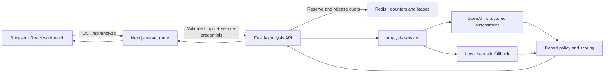

# JobFitProof

**Understand how your experience fits a job advert, with evidence behind the assessment.**

JobFitProof is a full-stack application that compares a CV with a job advert, identifies relevant evidence and asks the candidate to clarify information that the CV cannot establish. The resulting report separates demonstrated skills, partial evidence, confirmed gaps and unanswered questions.

The project is a local MVP intended to demonstrate an end-to-end product: a bilingual interface, a protected API, structured AI analysis, shared usage limits and automated tests. Public deployment has not yet been configured.

[Local setup](#local-setup) · [Architecture](#architecture) · [Frontend documentation](frontend/README.md) · [Backend documentation](backend/README.md)

## What the application does

- Compares pasted CV and job advert text against up to 12 assessed requirements.
- Supports British English (`en-GB`) and Castilian Spanish (`es-ES`), with a Junior, Mid or Senior target level.
- Distinguishes evidence in the CV from information supplied in clarification answers.
- Asks about material uncertainties instead of automatically treating missing information as a confirmed gap.
- Separates practical conditions, such as working hours and travel, from skills and experience.
- Produces a weighted evidence score, requirement-level explanations and suggested next steps.
- Exports a JSON report with evidence provenance, assessment metadata and separate skills and conditions arrays.
- Provides a clearly labelled, limited keyword-based fallback when AI analysis cannot complete.

## User journey

1. Paste a CV and a job advert, or load the included example.
2. Choose the interface/report language and target level.
3. Select **Analyse** to compare the supplied information.
4. Answer any clarification questions, or continue without answering.
5. Review the report and export it as JSON.

There is one optional clarification round. Submitting answers runs another analysis and consumes another quota reservation. Skipping all questions displays the existing draft without another API request. The application does not rewrite the original CV.

### How clarification works

The assessment asks: **Can this requirement reasonably be determined from the CV?**

| Decision | Behaviour |
| --- | --- |
| Yes | Evaluate the CV evidence. |
| Partially | Ask when the missing information is material; unresolved essential requirements receive priority. |
| No | Ask the candidate directly. |

Skills and language proficiency need a level or a concrete example for positive or partial answers. Practical conditions use **Yes / No / Depends**; only **Depends** requires additional context. For example, living in Spain does not establish willingness to attend a particular working schedule.

Unanswered questions remain visible as uncertainty. A confirmed incompatibility with working hours is shown separately from a skills gap.

### What the score means

The backend calculates the score from skills and experience requirements:

```text
score = round(100 × supported skill weight / total skill weight)

Met                → full requirement weight
Partially met      → half requirement weight
Not met / unknown  → no score contribution
```

Practical conditions are excluded from both sides of this calculation. Unknown requirements contribute no points but are not labelled as confirmed gaps. If no skills can be assessed, the interface shows no percentage and the exported score is `null`.

The result describes evidence coverage for the assessed requirements. It is not an employer's selection decision or a prediction of hiring success.

## Architecture



| Component | Responsibility |
| --- | --- |
| [Frontend](frontend/README.md) | Interface, language preference, clarification state, report display and JSON export. Its server route validates and forwards requests. |
| [Backend](backend/README.md) | Service authentication, independent validation, quota coordination, AI/fallback analysis and report calculation. |
| Redis | Shared rate limits, daily counters and expiring concurrency reservations. |
| OpenAI | Structured requirement assessment from the supplied CV, advert and optional answers. |

The backend is organised by feature, with routes, a controller, services and schemas inside `modules/analyses/`. There is no relational database or persisted candidate model: CVs and reports are processed per request, while Redis stores operational quota state. The backend README explains this structure in detail.

### Technology

| Area | Stack |
| --- | --- |
| Frontend | Next.js 16 App Router, React 19, TypeScript, Tailwind CSS 4, Base UI, Lucide |
| Backend | Node.js 22+, Fastify 5, TypeScript, Zod 4 |
| AI integration | OpenAI JavaScript SDK, Responses API, Structured Outputs; default model `gpt-5-mini` |
| Quotas | Redis, ioredis and an atomic Lua reservation script |
| Verification | Vitest, ESLint, TypeScript and production builds |

Dependency versions are recorded in each application's `package.json` and `package-lock.json`.

### Repository layout

```text
JobFitProof/
├── README.md               Project overview and local setup
├── compose.redis.yml       Local Redis service with persistent storage
├── frontend/
│   ├── README.md           Interface, proxy and frontend configuration
│   ├── app/                Next.js routes and global styles
│   ├── components/         Workbench, questions and shared UI
│   ├── lib/                Types, validation, translations and server proxy
│   └── package.json
└── backend/
    ├── README.md           API contract, analysis policy and operations
    ├── src/                Fastify application and analysis module
    ├── tests/              API, contract, security, AI and Redis tests
    └── package.json
```

The two applications have independent npm installations. There is no root `package.json` or root development script.

## Local setup

### Prerequisites

- Node.js **22 or later** and npm.
- Redis, either already running locally or started with the supplied Docker Compose configuration.
- Docker with the Compose plugin if using the container option.
- OpenSSL to generate the shared service secret.
- An OpenAI API key for AI analysis. Without it, only the limited heuristic fallback is available.

The following commands assume a Bash-compatible terminal opened at the repository root.

### 1. Install dependencies

```bash
npm --prefix backend ci
npm --prefix frontend ci
```

### 2. Configure the environment

Create the local configuration files if they do not already exist:

```bash
test -f backend/.env || cp backend/.env.example backend/.env
test -f frontend/.env.local || cp frontend/.env.example frontend/.env.local
```

Generate a service secret once:

```bash
openssl rand -hex 32
```

Copy the generated value into `INTERNAL_API_SECRET` in **both** files. It must be the same 64-character, lower-case hexadecimal value. The placeholders below must be replaced before starting the applications.

Relevant values in `backend/.env`:

```dotenv
INTERNAL_API_SECRET=<generated-secret>
REDIS_URL=redis://127.0.0.1:6379
CORS_ORIGIN=http://127.0.0.1:3000
OPENAI_API_KEY=<your-openai-api-key>
OPENAI_MODEL=gpt-5-mini
OPENAI_TIMEOUT_MS=60000
```

For heuristic-only development, leave `OPENAI_API_KEY` empty instead of using a placeholder.

Relevant values in `frontend/.env.local`:

```dotenv
BACKEND_API_URL=http://127.0.0.1:4000
INTERNAL_API_SECRET=<same-generated-secret>
APP_ORIGIN=http://127.0.0.1:3000
TRUSTED_CLIENT_IP_HEADER=
BACKEND_TIMEOUT_MS=75000
```

The environment files are ignored by Git. Keep credentials out of source control and do not use a `NEXT_PUBLIC_` prefix for secrets.

### 3. Start Redis

If using Docker Compose:

```bash
docker compose -f compose.redis.yml up -d
docker compose -f compose.redis.yml exec redis redis-cli ping
```

If Redis is already running locally, use that instance instead:

```bash
redis-cli -h 127.0.0.1 -p 6379 ping
```

The expected reply is `PONG`. Choose one Redis setup; both would otherwise compete for port 6379. The Compose service binds to loopback and uses a named volume, append-only persistence and a `noeviction` policy.

### 4. Start the applications

In one terminal, from the repository root:

```bash
npm --prefix backend run dev
```

In a second terminal, also from the repository root:

```bash
npm --prefix frontend run dev -- --webpack --hostname 127.0.0.1
```

Open [http://127.0.0.1:3000](http://127.0.0.1:3000). This command uses the Webpack development option; `npm run dev` inside `frontend/` uses Next.js's default bundler.

`APP_ORIGIN` must exactly match the browser address, including scheme and port. Using `localhost` instead of `127.0.0.1` requires changing that value. Restart both applications after pulling changes or editing environment configuration.

### 5. Check the setup

```bash
curl -fsS http://127.0.0.1:4000/health
```

The health endpoint checks that the API process is responding. It does not check Redis, OpenAI or the complete analysis flow. Use the included sample in the interface to verify the full flow; a real analysis uses API quota and may incur provider charges. The report identifies whether its source is AI or the basic fallback.

## Development checks

Run these commands from the repository root:

```bash
npm --prefix frontend run lint
npm --prefix frontend run build -- --webpack
npm --prefix backend run typecheck
npm --prefix backend run build
npm --prefix backend test
```

The normal test suite does not call OpenAI. Redis integration tests are skipped unless `REDIS_TEST_URL` is provided; see [backend testing](backend/README.md#testing) for the separate command. Tests in `backend/tests/` also exercise the frontend proxy and input validator, so both dependency sets must be installed.

For dependency checks, run `npm audit` inside each application. There is currently no committed automated browser-test suite.

## Security and data handling

The browser sends analysis requests to its own Next.js origin. Next.js validates the input and adds server-only credentials before contacting Fastify. The backend validates again before reserving quota. Limits are shared through Redis, and analysis is blocked if Redis is unavailable.

Default limits are three admitted requests per client per ten-minute window, ten per client per UTC day, fifty globally per UTC day and two concurrent analyses. Clarification submissions count as requests too. These controls are separate from provider spending settings and do not provide user authentication.

CVs, job adverts, answers and reports are held in browser memory during the session; only the language preference is stored in `localStorage`. Redis stores counters, hashed client identifiers and reservation IDs, not CV content. In AI mode, the supplied text and answers are sent to OpenAI with `store: false`. Downloaded reports may contain personal information from the submitted evidence.

Public error responses use controlled messages. The API and proxy reject oversized or invalid inputs, and the proxy requires HTTPS for remote backend connections. Detailed controls and configuration are documented in the [frontend](frontend/README.md#server-proxy) and [backend](backend/README.md#security-and-privacy) READMEs.

## Limitations and next steps

- The current input format is pasted text. PDF/DOCX upload, accounts and saved report history are not implemented.
- Each analysis assesses at most 12 requirements, so long adverts may contain additional criteria that need separate review.
- AI assessments can vary and should be checked against the original advert and supplied evidence. Candidate answers remain self-reported.
- The heuristic fallback recognises a small predefined vocabulary, mainly related to software roles, plus some practical conditions. It cannot provide comprehensive analysis of arbitrary occupations or reliably assess proficiency levels.
- A strong skills score can coexist with an incompatible practical condition. Both parts of the report need review.
- Public hosting, a trusted ingress configuration and operational monitoring remain to be configured. `next start` applies production safeguards and is not a substitute for the local development command.

Possible next steps include a hosted demo, a committed browser-test suite and evaluation cases across a broader range of occupations. These are future improvements, not current features.

## Troubleshooting

| Symptom | Check |
| --- | --- |
| Backend exits with an environment validation error | `backend/.env` exists; the shared secret is valid and `REDIS_URL` is set. |
| Redis reports `Connection is closed` or analysis is unavailable immediately | Redis is running at the configured address. Confirm `PONG` and use the intended database. |
| The request is rejected from the browser | Open the exact `APP_ORIGIN`; check protocol, hostname and port. |
| Analysis is temporarily unavailable | Inspect the backend terminal and request ID. Check service credentials, Redis and the running backend version. |
| The report is labelled as a basic review | Check the OpenAI key, model configuration, provider availability and timeout. |
| An updated frontend fails against a running backend | Stop and restart the backend so it returns the current report contract, including the question arrays. |
| A rate or daily limit is reached | Wait for the stated retry window or the next UTC day, as appropriate. |

## Licence

This repository does not currently include a licence file.
